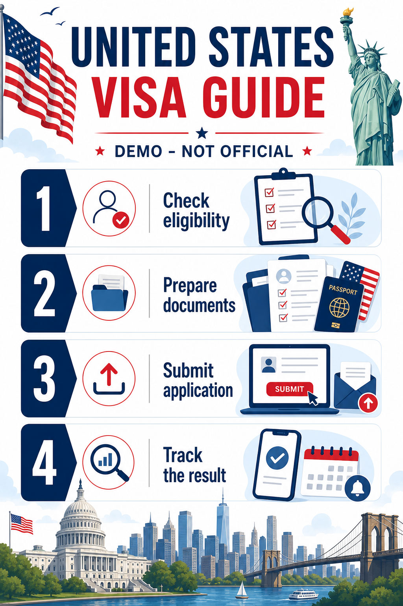
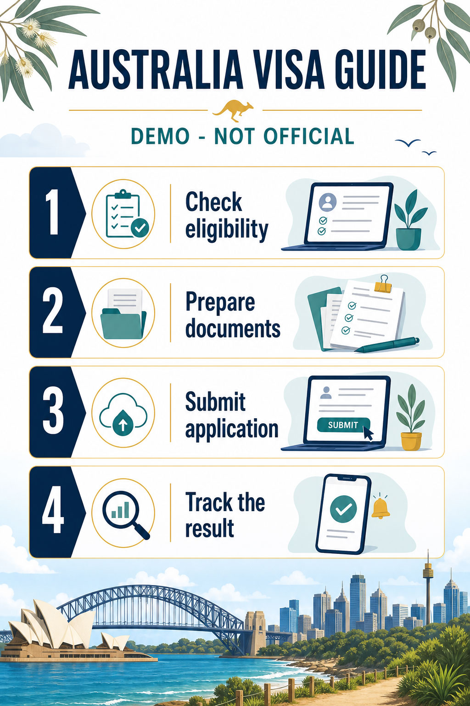
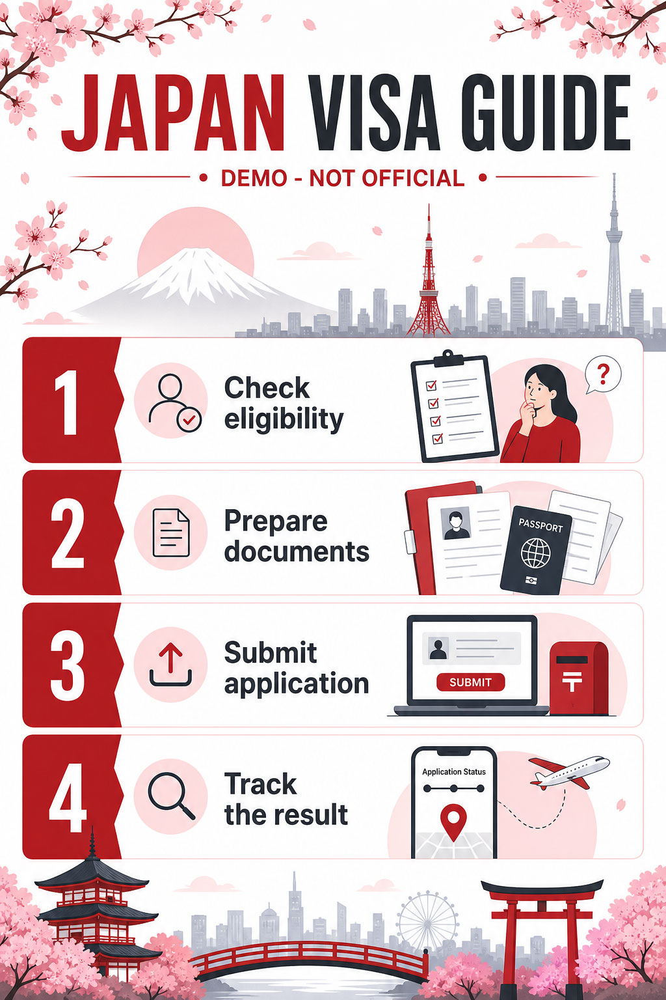

# Chada Travel - Agency Manager

[](https://github.com/markwebdev86/chada-travel/releases)
[](LICENSE.txt)
[](https://wordpress.org/plugins/chada-travel/)
[](https://github.com/markwebdev86/chada-travel/issues)

Chada Travel - Agency Manager is a WordPress plugin for travel agencies. It provides Tour management, Visa Country
content, customer applications, bookings, documents, checkout, manual payments, public Tour pages, and operational
administration tools.

The Free plugin is a complete, standalone GPL-2.0-or-later release. Download the WordPress.org package from the
[plugin directory](https://wordpress.org/plugins/chada-travel/), or download a ZIP release artifact from
[GitHub Releases](https://github.com/markwebdev86/chada-travel/releases). Independent extensions, including a separately
distributed Pro edition, may add functionality through the documented extension contracts.

## Requirements

- WordPress 6.6 or later.
- PHP 7.4 or later.
- A database supported by the installed WordPress version.
- HTTPS is recommended for administration and customer-facing workflows.

### PHP runtime settings

Chada Travel does not read or change PHP execution-time or socket-timeout settings. Installation, migrations, image
processing, and Pro workbook operations run within the limits configured by the hosting provider. PHP, web-server,
upload, and proxy limits remain the hosting administrator's responsibility.

## Privacy and safety

Regional values are configured manually in General Settings. The plugin does not require a third-party regional lookup
service and does not send installer or customer data to any third-party regional lookup.

Payment proofs and Visa documents are stored in plugin-managed protected storage and are served only through authorized
workflows. Administrative forms use WordPress nonces and capability checks. Stored and displayed values are validated,
sanitized, escaped for their output context, and processed with bounded upload and request rules.

## Features

### Free plugin

- Create, edit, duplicate, archive, restore, search, filter, and publish Tours with dates, pricing, files, and public detail pages.
- Manage built-in Tour Destinations and Tour Types, Featured Tours, public Tour Search, and Tour Featured Images.
- Manage Visa Countries, fees, guide content, requirements, images, and public country pages.
- Provide a staged customer checkout for visa applications, Bank Payment, and Digital Wallet payments.
- Review bookings and payment proofs, release protected documents, send workflow notifications, and retain audit history.
- Configure company information, policies and consent, payments, pages and links, documents and uploads, Tours, Visa Countries, and email.
- Use the built-in WordPress mail path, optional encrypted SMTP settings, and the plugin-owned durable email queue.
- Use the public REST API under `chada-travel/v1` for checkout, payment, confirmation, proof upload, document listing, and document upload workflows.
- Configure company country, address country, timezone, currency, and date and time formats manually.
- Use stable actions and filters to connect independent payment, administration, settings, REST, dashboard, automation, and template extensions.

### Independent Pro and extension capabilities

The separately distributed Pro edition and other extensions can add capabilities without changing the Free plugin’s core
records. The documented feature set includes:

- Custom Tour Type management and complete Tour export/import workbooks. The Pro transfer uses the shared
  `taapp_tours_workbook` XLSX v2 contract, while Free continues to own Tours, Tour Destinations, Tour Types, and the
  `chada_travel_admin_tours_transfer_html` extension seam.
- Server-side record grids, tags, assignments, internal notes, and booking-detail extensions.
- Booking workflow settings, bounded archive and expired-draft automation, retention review, and anonymization safeguards.
- PayPal and PayMongo integrations with provider-specific checkout, webhook, REST, and payment-state handling.
- Interactive administrator guidance and additional locally bundled extension assets.
- Pro Booking Workflow saves return a dedicated success notice while preserving the shared Free settings notice contract.

Extension authors are responsible for their own provider authentication, remote requests, authorization, settings, data
retention, migrations, and tests. Extensions must not weaken WordPress capability, nonce, validation, or protected-file
controls.

## Installation

### WordPress dashboard

1. In WordPress, open **Plugins > Add New Plugin**.
2. Search for **Chada Travel - Agency Manager** and select **Install Now**.
3. Select **Activate**.
4. Open **Chada Travel > Settings** and complete the setup tabs.

### GitHub release artifact

1. Open the [GitHub Releases](https://github.com/markwebdev86/chada-travel/releases) page.
2. Download the current `chada-travel-<version>.zip` artifact.
3. In WordPress, open **Plugins > Add New Plugin > Upload Plugin**.
4. Upload the ZIP, install it, and activate **Chada Travel - Agency Manager**.

Install any independent extension as a separate WordPress plugin using the release instructions supplied by that
extension. Activate the Free plugin first so its core tables, capabilities, settings, and public contracts are available.

## Usage

Open **Chada Travel > Settings** to configure General, Policies & Consent, Payment Method, Pages & Links, Documents &
Uploads, Tours, Visa Countries, and Email. The plugin can provision or adopt the pages used by the customer workflows.
Review the Dashboard readiness notices before accepting customer applications.

The primary checkout shortcode is:

```text
[chada_travel_visa_application]
```

Other public shortcodes include:

```text
[chada_travel_payment_proof]
[chada_travel_visa_documents]
[chada_travel_tour_search_form]
[chada_travel_tour_search_results]
[chada_travel_featured_tours_sidebar rows="3"]
[chada_travel_featured_tours design="bg-image" rows="1" columns="3"]
```

Place shortcodes in ordinary WordPress Pages, blocks, or compatible page-builder shortcode modules. The generated Tours
page supports browsing, filtering, pagination, and automatic Tour Destination and Tour Type archive links.

## WordPress.org plugin assets

Review the WordPress.org banners, icons, and checkout screenshots in [`docs/images/`](docs/images/). The screenshot
captions below match the numbered files in [`readme.txt`](readme.txt). Copy these assets to the plugin's top-level
WordPress.org SVN `assets/` directory when preparing a directory release.

- **Banners:** [772 × 250](docs/images/banner-772x250.jpg) ·
  [1544 × 500 Retina](docs/images/banner-1544x500.jpg)
- **Icons:** [128 × 128](docs/images/icon-128x128.png) · [256 × 256 Retina](docs/images/icon-256x256.png) ·
  [SVG](docs/images/icon.svg)
- **Checkout screenshots:**
  - [1 · Countries and cart](docs/images/screenshot-1.png)
  - [2 · Booker and applicants](docs/images/screenshot-2.png)
  - [3 · Review and total](docs/images/screenshot-3.png)
  - [4 · Payment choice](docs/images/screenshot-4.png)
  - [5 · Bank payment confirmation](docs/images/screenshot-5.png)

## Project reference values

| Reference | Value |
|---|---|
| Project name | `Chada Travel - Agency Manager` |
| Admin menu label | `Chada Travel` |
| Free plugin slug and folder | `chada-travel` |
| Free PHP namespace | `CHADA_TRAVEL\\` |
| Free text domain | `chada-travel` |
| Free database prefix | `chada_travel_` |
| Free REST namespace | `chada-travel/v1` |
| Free version | `1.0.0` |
| Free database schema version | `3.3.0` |
| Settings-data version | `23` |
| Pro extension slug and folder | `chada-travel-pro` |
| Pro PHP constant prefix | `CHADA_TRAVEL_PRO_` |
| Pro version | `1.0.0` |

The Free plugin owns the `chada_travel_*` tables, options, capabilities, hooks, shortcodes, and REST namespace. Activation
seeds missing catalog records without overwriting existing records or relationships. Repeated activation is idempotent.
Uninstall retains plugin data by default; explicit cleanup requires `CHADA_TRAVEL_REMOVE_DATA_ON_UNINSTALL` to be enabled.

## Database table structure

The Free plugin creates the core tables for orders, applicants, applications, Visa Countries, requirements, documents,
payments, Tours, Tour dates, Tour files, Tour terms, Tour-term relationships, audit events, and the email queue. The
independent Pro extension adds its own additive records, including tags and record-tag relationships.

See the [complete database table structure](docs/database-table-structure.md) for table columns, indexes, ownership,
options, lifecycle behavior, extension boundaries, and the current Entity Relationship Diagram. The ERD keeps an editable
Mermaid source block for GitHub-compatible viewers and includes a synchronized SVG fallback for Markdown viewers that do
not render Mermaid.

## Screenshots

The repository includes public Visa workflow demonstration assets:







## Frequently asked questions

### Is the Free plugin usable by itself?

Yes. It is a standalone plugin with Tour, Visa Country, checkout, payment, document, email, and administration workflows.

### Is an extension required for the core checkout?

No. Bank Payment and Digital Wallet are included. Independent extensions can register additional providers or workflows.

### How are regional settings configured?

Administrators configure company country, address country, timezone, currency, and date and time formats manually in
General Settings. No third-party regional lookup service is required.

### Where are customer uploads stored?

Payment proofs and Visa documents are stored in protected plugin-managed storage and served only by authorized workflows.

### Does Chada Travel change PHP execution time or timeout settings?

No. Chada Travel does not read or change PHP execution-time or socket-timeout settings. Installation, migrations, image
processing, and Pro workbook operations use the limits configured by the hosting provider. If an operation times out,
contact the hosting provider about its PHP, web-server, upload, or proxy limits.

### Can the plugin be extended?

Yes. Extensions can use the stable contracts listed below for payment providers, administration, settings, REST, Dashboard,
automation, booking details, templates, and public workflow integration.

## Administration

Administrators manage the plugin from the **Chada Travel** menu. The Dashboard reports checkout readiness and recent
booking activity. Settings centralize company details, policies, pages, payment methods, documents, Tours, Visa Countries,
email delivery, and regional configuration. The Features screen describes the capabilities available in the active edition.

The Tours, Tour Destinations, and Tour Types tables provide sequential row numbers. Tour names open their public view in a
new tab, and View/Edit actions identify the selected row for easier administration.

## Free release

The Free release is distributed under GPL-2.0-or-later through WordPress.org and as a ZIP artifact on GitHub Releases.
It is self-contained and does not require a separate mail, scheduling, analytics, licensing, or telemetry service.

## Extension contracts

Independent extensions may register additive behavior through these stable hooks and filters:

```text
chada_travel_register_payment_providers
chada_travel_register_admin_extensions
chada_travel_register_settings_extensions
chada_travel_register_rest_extensions
chada_travel_register_dashboard_extensions
chada_travel_register_automation_extensions
chada_travel_render_dashboard_extensions
chada_travel_dashboard_cards
chada_travel_settings_tabs
chada_travel_instructions_tabs
chada_travel_booking_detail_overview_extensions
chada_travel_booking_detail_payment_state_extensions
chada_travel_template_path
chada_travel_payment_settings_tentative_ready
chada_travel_admin_tours_transfer_html
```

These contracts are additive. An extension owns its own providers, assets, settings, migrations, and tests while using the
Free plugin’s documented authorization and data contracts.

## Contributing

Bug reports, feature proposals, documentation improvements, and pull requests are welcome through the
[GitHub issue tracker](https://github.com/markwebdev86/chada-travel/issues). Keep pull requests focused, include tests
for behavior changes, update relevant public documentation, and never include sensitive configuration, private URLs,
generated runtime data, or customer information.

Before opening a pull request, run the applicable checks:

```powershell
composer check
npm run lint:js
npm run lint:js:tour
npm run build:release
git diff --check
```

## Release verification

Release verification covers PHP syntax and static analysis, PHPUnit, integration harnesses, JavaScript syntax, package
contents, WordPress metadata, public documentation, and whitespace checks. The release build creates the curated
`dist/chada-travel/` package and its versioned ZIP artifact while excluding tests, development-only files, sensitive
configuration, and unrelated extension assets. The ZIP preserves the approved `chada-travel/` plugin folder at its
archive root so the release identity is explicit during package inspection and installation.

The latest Free-edition UAT coverage and retained wp-env records are documented in
[docs/UAT-Free-2026-09-11.md](docs/UAT-Free-2026-09-11.md).

## Support and support boundaries

- Report reproducible bugs and request improvements through [GitHub Issues](https://github.com/markwebdev86/chada-travel/issues).
- Ask WordPress installation and usage questions in the [WordPress.org support forum](https://wordpress.org/support/plugin/chada-travel/).
- For an independent extension, report provider-specific behavior to that extension’s maintainer after confirming the core Free workflow independently.
- Do not post sensitive configuration, payment details, customer documents, private URLs, or other protected information in public support channels.

## License

Chada Travel is distributed under the [GNU General Public License, version 2 or later](LICENSE.txt).

The bundled GLightbox assets are distributed under the MIT License; the applicable notice is included at
[`assets/vendor/glightbox/LICENSE.md`](assets/vendor/glightbox/LICENSE.md).
